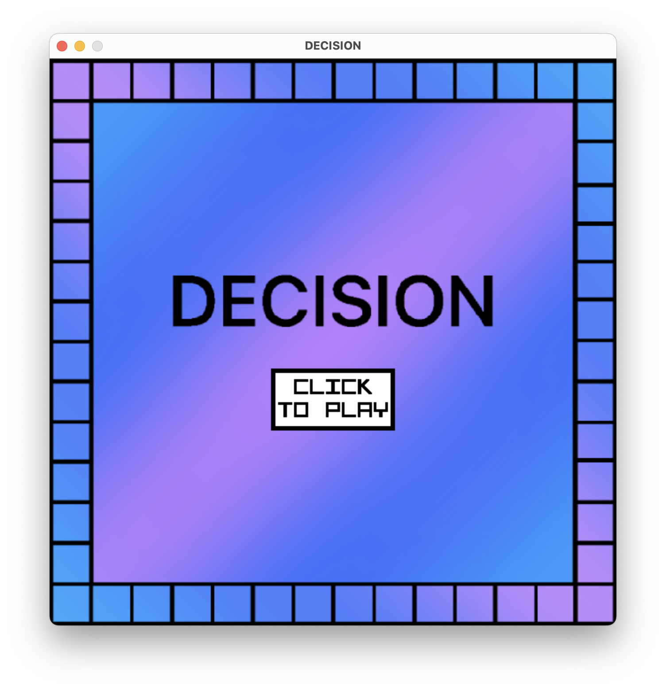
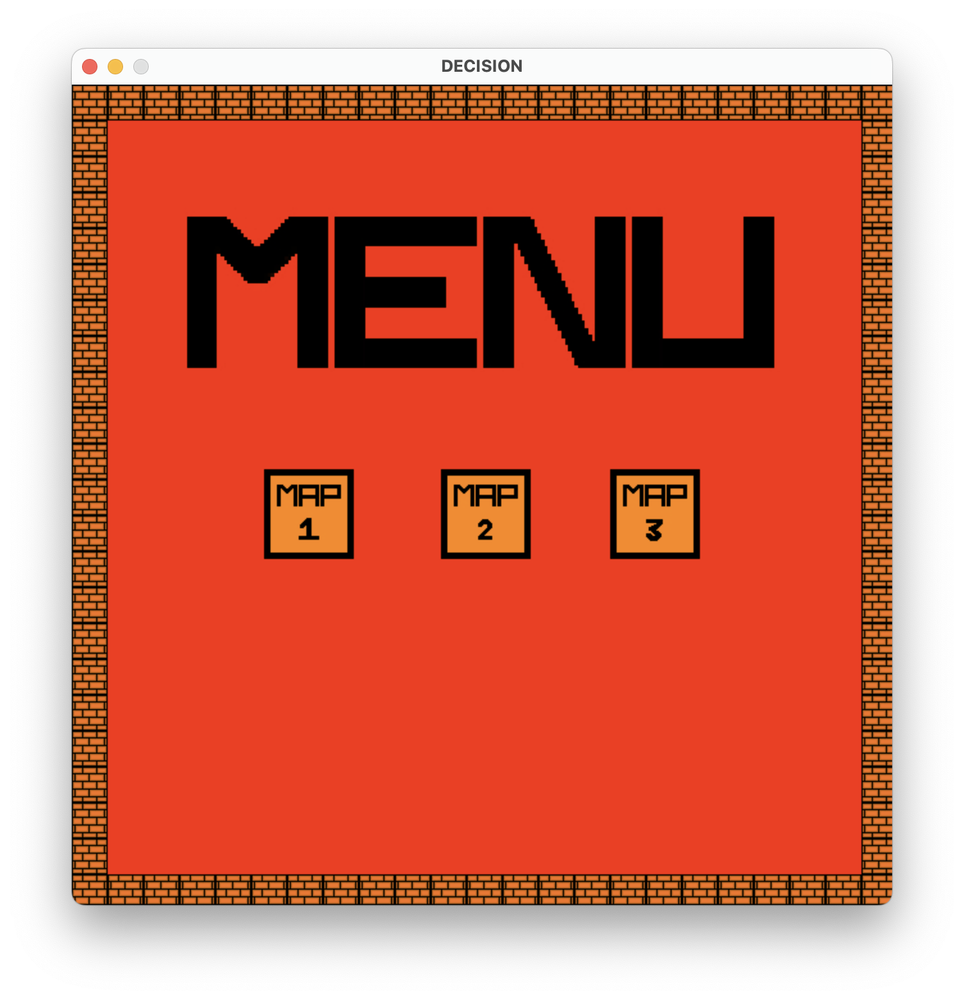
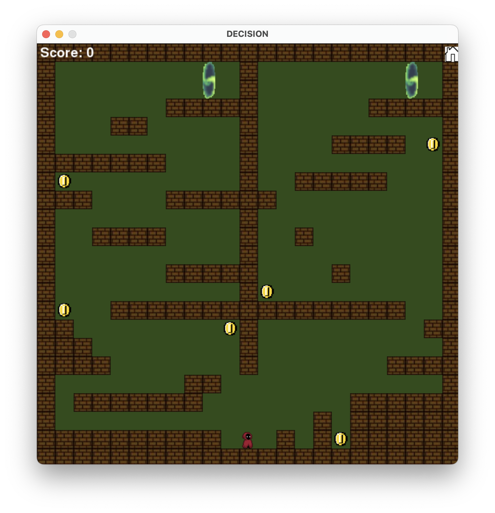
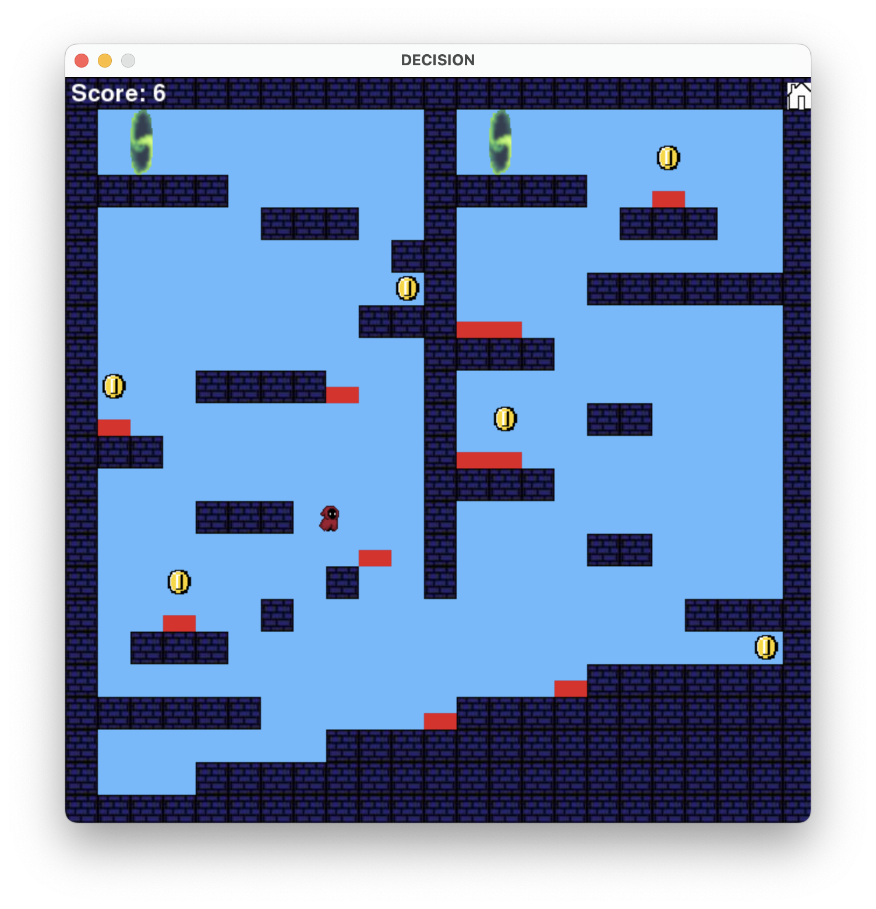
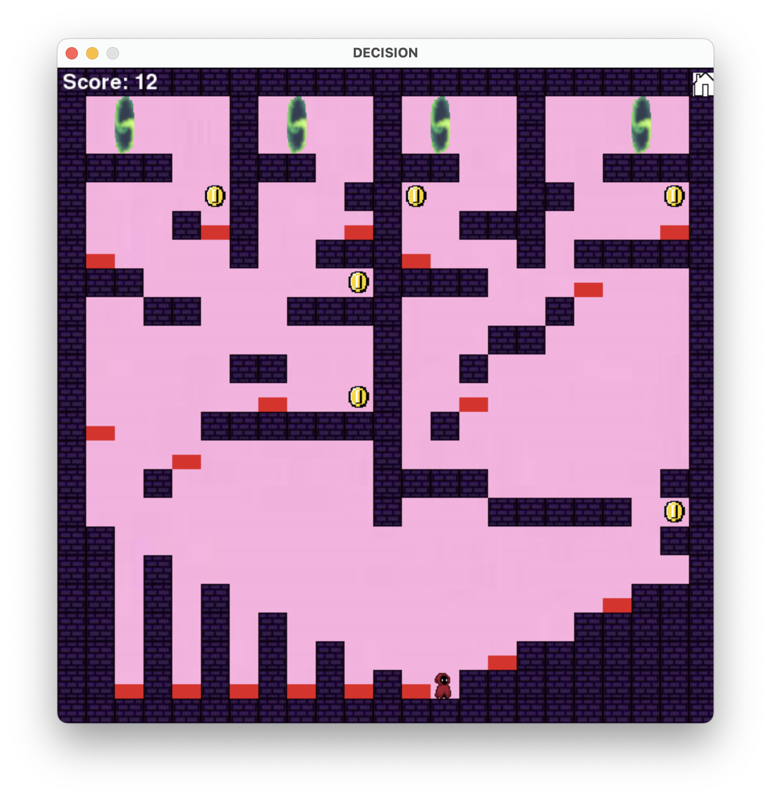

# DECISON
A 2D Python game developed using Pygame. The player must navigate through three different maps with increasing difficulty to find the correct teleport to progress through each level while collecting coins and avoiding kill zones.

Features:
- Three playable maps with increasing difficulty.
- Randomised teleportation mechanics to progress between levels.
- Collectable coins with a displayed score.
- Kill zones that the player must avoid.
- Menu screen that can be accessed from each map.
- Title screen.
- Character animations using various sprites to show the character movement.

Technologies:
- Python
- Pygame
- Object-Orientated Programming

How to run:
1. Download or clone repository.
2. Install Python.
3. Install Pygame using "pip install pygame".
4. Run the main Python file "DECISION.py".
 
Screenshots:
- Title Screen: 
- Menu Screen: 
- Map1: 
- Map2: 
- Map3: 
